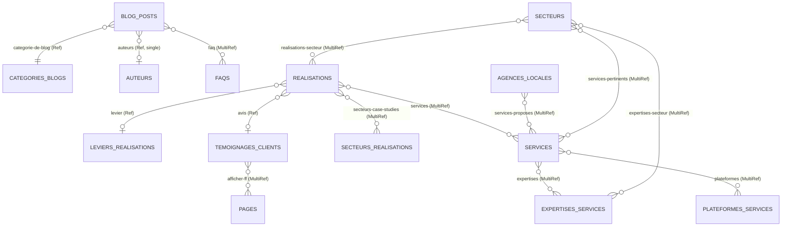

# CMS Webflow — Blinked

Audit **en lecture seule** du CMS du site Webflow « Blinked » réalisé le 17/11/2026 via l'API (MCP Webflow).

- Site ID : `6979ce915767387cd0f9aa37` (shortName `blinkedxmekaa`)
- Prod : `www.blinked.fr` (+ `blinked.fr`), **dernière publication sur le domaine custom : 09/09/2026**
- Staging : `blinkedxmekaa.webflow.io`, dernière publication : 17/11/2026 → le staging est en avance sur la prod
- Locale : une seule, **français** (`fr`, locale id `6979ce915767387cd0f9aa39`, **cmsLocaleId `6979ce915767387cd0f9aa3a`**), aucune locale secondaire, localisation non activée (`enabled: false`). Tous les items portent ce même `cmsLocaleId`.
- Convention de nommage : préfixe 🌐 = collection avec page template publiée (URL publique par item), 🔒 = collection « données » dont le template n'est pas publié (`shouldPublish: false`), utilisée uniquement via des Collection Lists / références.

---

## 1. Vue d'ensemble des collections

Comptes : P = publiés (non brouillon, `lastPublished` renseigné), D = brouillons (`isDraft: true`), A = archivés. Aucun item archivé sur tout le site.

| # | Nom affiché | Slug (URL) | Collection ID | Items | P / D / A | Page template | URL item |
|---|---|---|---|---|---|---|---|
| 1 | 🌐 Blog Posts | `blog` | `6979ce915767387cd0f9aa5a` | 95 | 86 / 9 / 0 | 🌐 Blog Posts Template (`6979ce915767387cd0f9aa2c`) — publiée | `/blog/{slug}` |
| 2 | 🔒 Catégories Blogs | `categories` | `6979ce915767387cd0f9aa77` | 13 | 13 / 0 / 0 | 🔒 Catégories Blogs Template (`…aa2d`) — non publiée | — |
| 3 | 🔒 Auteurs | `auteurs` | `6979ce915767387cd0f9aa8d` | 3 | 2 / 1 / 0 | 🔒 Auteurs Template (`…aa2e`) — non publiée | — |
| 4 | 🔒FAQs | `faq` | `6979ce915767387cd0f9aaab` | **498** | 498 / 0 / 0 | 🔒FAQs Template (`…aa2f`) — non publiée | — |
| 5 | 🌐 Lexiques | `lexiques` | `6979ce915767387cd0f9aaae` | 1 | 1 / 0 / 0 | 🌐 Lexiques Template (`6979ce915767387cd0f9aa32`) — publiée | `/lexiques/{slug}` |
| 6 | 🌐 Réalisations | `case-studie` | `697a20ee8df42c6ad431dab2` | 7 | 1 / 6 / 0 | 🌐 Réalisations Template (`697a20f08df42c6ad431db12`) — publiée | `/case-studie/{slug}` |
| 7 | 🔒 Secteurs Réalisations | `tag-case-studies` | `697a20fdc2bcd3ad6fbc0895` | 3 | 3 / 0 / 0 | 🔒 … Template (`697a20fdc2bcd3ad6fbc08d5`) — non publiée | — |
| 8 | 🌐 Services | `services` | `697b2af92401518c369002df` | 4 | 2 / 2 / 0 | 🌐 Services Template (`697b2af92401518c369002e6`) — publiée | `/services/{slug}` |
| 9 | 🔒 Plateformes Services | `plateformes-services` | `697b340231c56641c73f07eb` | 14 | 14 / 0 / 0 | 🔒 … Template (`697b340231c56641c73f07f1`) — non publiée | — |
| 10 | 🔒 Expertises Services | `expertises-services` | `6989a7ec270eaaabebeccb3a` | 19 | 19 / 0 / 0 | 🔒 … Template (`6989a7ec270eaaabebeccb41`) — non publiée | — |
| 11 | 🔒 Témoignages clients | `temoignages-clients` | `6989c18baf40ba26075f24f3` | 6 | 6 / 0 / 0 | 🔒 … Template (`6989c18baf40ba26075f24f9`) — non publiée | — |
| 12 | 🔒 Equipes | `equipe` | `6989e8b1465b61765c730ebb` | 7 | 7 / 0 / 0 | 🔒 … Template (`6989e8b1465b61765c730ec3`) — non publiée | — |
| 13 | 🔒 Leviers Réalisations | `leviers-realisations` | `698b094a4395ec816c392c18` | 4 | 4 / 0 / 0 | 🔒 … Template (`698b094a4395ec816c392c20`) — non publiée | — |
| 14 | 🔒 Pages | `pages` | `698decf1a1e41f7694d489ef` | 2 | 2 / 0 / 0 | 🔒 Pages Template (`698decf1a1e41f7694d489fb`) — non publiée | — |
| 15 | 🌐 Agences locales | `agences-locales` | `6a1e28ff7b3bf440c957cc77` | **0** | 0 / 0 / 0 | 🌐 Agences locales Template (`6a1e28ff7b3bf440c957cc7d`) — publiée | `/agences-locales/{slug}` |
| 16 | 🌐 Secteurs | `secteurs` | `6a1e28ff7ae5651ba4263e0c` | **0** | 0 / 0 / 0 | 🌐 Secteurs Template (`6a1e28ff7ae5651ba4263e12`) — publiée | `/secteurs/{slug}` |

Pages statiques « liste » associées : `/blog` (Blog), `/services` (Services), `/realisations` (Réalisations), `/lexique` (Lexique). Attention, la page liste des réalisations est `/realisations` mais les fiches sont sous `/case-studie/…` ; la page liste du lexique est `/lexique` mais les fiches sont sous `/lexiques/…`.

SEO des templates publiés (champs dynamiques) :

| Template | Title | Description | OG image |
|---|---|---|---|
| Blog Posts | `seo-meta-title` | `seo-meta-desc` | `image-vignette` |
| Réalisations | `seo-meta-title` | `seo-meta-desc` | `overlay` |
| Services | `seo-meta-title` | `seo-meta-desc` | — |
| Lexiques | `name` + `seo-metatitle` (concaténés) | `seo-metadescription` | — |
| Agences locales | `seo-meta-title` | `seo-meta-desc` | — |
| Secteurs | `seo-meta-title` | `seo-meta-desc` | — |

---

## 2. Schéma des relations

Collections sans aucune relation : 🌐 Lexiques, 🔒 Equipes.
Hubs : **Services** (ciblé par Réalisations, Agences locales, Secteurs) et **Expertises Services** (ciblé par Services, Secteurs).
Aucune référence cassée (ID pointant vers un item inexistant) n'a été trouvée.

---

## 3. Détail par collection

Légende : **R** = requis. Tous les champs sont éditables. `name` et `slug` sont les champs système (toujours requis, max 256 car.). « 1 ligne » = PlainText `singleLine: true` ; « multi » = PlainText multiligne.

### 3.1 🌐 Blog Posts — `blog` (`6979ce915767387cd0f9aa5a`)

| Nom affiché | Slug | Type | R | Notes |
|---|---|---|---|---|
| Titre de l'article | `name` | PlainText | R | |
| Slug | `slug` | PlainText | R | |
| Image vignette | `image-vignette` | Image | | aussi OG image du template |
| Temps de lecture en minute | `temps-de-lecture-en-minute` | PlainText 1 ligne | | **nombre stocké en texte** (« 5 ») |
| Date de publication | `date-de-publication` | DateTime | | ISO UTC ; de 2025-02-06 à 2026-07-07 |
| Intro | `intro` | RichText | | vide sur 5 articles |
| Contenu de l'article | `contenu-de-l-article` | RichText | | jusqu'à ~21 000 car. HTML |
| Catégorie de blog | `categorie-de-blog` | Reference → Catégories Blogs | | renseigné sur 95/95 |
| Auteurs | `auteurs` | Reference (simple) → Auteurs | | **1 seul article renseigné** |
| FAQ | `faq` | MultiReference → FAQs | | 90/95 articles, 3 à 8 FAQ par article (5 en général) |
| FAQ_HTML | `faq-html` | RichText | | **champ alternatif, utilisé sur 1 seul article** (`sea-google-ads`) |
| SEO / Meta-title | `seo-meta-title` | PlainText 1 ligne | | SEO — 95/95 |
| SEO / Meta-desc | `seo-meta-desc` | PlainText 1 ligne | | SEO — 90/95 |
| Page | `page` | Option | | options : `Lexique` (id `27749cf32912985d80106ea4d90f43b6`) — **jamais utilisé** |

Usage des catégories : Publicité sectorielle 22, Formats & Campagnes Google Ads 18, Métriques & Budget Google Ads 14, Agences & Conseil 12, Stratégie Google Ads 10, Gestion de compte Google Ads 6, Google Ads sectoriel 6, SEA / Search Ads 2, Stratégie 2, Expertise 2, Data & Analytics 1. Les catégories « Programmatique & Display » et « Social Ads / SMA » n'ont aucun article.

Brouillons (9, jamais publiés) : `strategie-publicite-plombier-seo-sea`, `guide-publicite-communication-notaire`, `publicite-dentiste-loi`, `guide-publicite-electricien`, `publicite-bricolage-decoration`, `guide-publicite-communication-medecin`, `publier-offre-emploi-publicite`, `guide-publicite-artisan-local`, `guide-publicite-ecole-recrutement`.

Contenu riche : HTML Webflow standard (`p`, `h2`, `h3`, `h4`, `ul/ol/li`, `strong`, `a`, `figure` image). **89 articles contiennent un `<table>` injecté dans un embed `
` avec style inline** (`width:100%;border-collapse:collapse;…`). 1 iframe YouTube. Pas de Markdown brut détecté.

**Exemple** (`6a1d92ef94d3e5430555391d`, publié) :
- name : « Agence Google Ads : pilotage et performance pour PME, ETI et grands comptes » — slug `sea-google-ads`
- image-vignette : `…_sea-google-ads.webp` (alt « Agence Google Ads — illustration Blinked »)
- temps-de-lecture-en-minute : `"11"` — date-de-publication : `2026-07-01T11:27:00.000Z`
- intro : « Google Ads représente une opportunité de croissance majeure, mais sa complexité technique et stratégique est un défi constant. Sans une expertise pointue, les budgets peuvent être gaspillés et les rés… »
- contenu : « Pourquoi confier votre Google Ads à une agence Google Partner — Le choix d'un partenaire pour gérer vos investissements publicitaires est une décision stratégique… »
- categorie-de-blog → « SEA / Search Ads » ; auteurs → « Claire Gicquel » ; faq : vide ; faq-html : « Nous répondons ici aux questions les plus fréquentes… Quel budget Google Ads minimum pour une PME ? … »
- seo-meta-title : « Agence Google Ads : performance pour PME et ETI » ; seo-meta-desc : « Agence Google Ads Blinked : pilotage et performance SEA pour PME, ETI et grands comptes. Audit gratuit… »

### 3.2 🔒 Catégories Blogs — `categories` (`6979ce915767387cd0f9aa77`)

| Nom affiché | Slug | Type | R |
|---|---|---|---|
| Nom de la catégories | `name` | PlainText | R |
| Slug | `slug` | PlainText | R |

13 items : SEA / Search Ads (`sea-search-ads`), Programmatique & Display, Social Ads / SMA, Agences & Conseil, Publicité sectorielle, Google Ads sectoriel, Gestion de compte Google Ads, Formats & Campagnes Google Ads, Métriques & Budget Google Ads, Stratégie Google Ads, Data & Analytics, Stratégie, Expertise.
**Exemple** : `6a1d925d016b908e987899c3` — « SEA / Search Ads » / `sea-search-ads`.

### 3.3 🔒 Auteurs — `auteurs` (`6979ce915767387cd0f9aa8d`)

| Nom affiché | Slug | Type | R | Notes |
|---|---|---|---|---|
| Prénom Nom | `name` | PlainText | R | |
| Slug | `slug` | PlainText | R | |
| Image profil | `image-profil` | Image | | **vide sur les 3 items** |
| poste | `poste` | PlainText 1 ligne | | |
| Lien profil LinkedIn | `lien-profil-linkedin` | Link | | |
| Informations | `informations` | PlainText 1 ligne | | courte bio |

Items : Quentin Lemonnier (Fondateur & CEO), Claire Gicquel (Head of SEA), « Nom prénom » (brouillon placeholder, LinkedIn = `http://www.google.com`).
**Exemple** : `6a1d91284b76bf6a209d522b` — Quentin Lemonnier, poste « Fondateur & CEO », LinkedIn `https://fr.linkedin.com/in/blinked` (lien d'entreprise, pas un profil perso), informations « Fondateur et CEO de Blinked, agence média du Groupe Jaws spécialisée en SEA, Social Ads et Programmatique. »

### 3.4 🔒FAQs — `faq` (`6979ce915767387cd0f9aaab`)

| Nom affiché | Slug | Type | R |
|---|---|---|---|
| Question | `name` | PlainText | R |
| Slug | `slug` | PlainText | R |
| Réponses | `reponses` | RichText | |

498 items, tous publiés. Slug généré sous la forme `{slug-article}-q{n}-{question-tronquée}` (ex. `creer-compte-google-ads-expert-q6-comment-securiser-les-acces-lors-de-la-d`), donc chaque FAQ est attachée à un article précis. 459 FAQ sont référencées par un article, **39 orphelines**, 3 questions en doublon exact.
**Exemple** : `6a0c76eccb75103bf438bb60` — Q : « Comment sécuriser les accès lors de la délégation à une agence partenaire ? » — R : « La sécurité de vos actifs financiers est une priorité. Vous devez définir des permissions strictes entre les accès "Standard" et "Administrateur". Il est impératif d'inviter vos collaborateurs ou votr… »

### 3.5 🌐 Lexiques — `lexiques` (`6979ce915767387cd0f9aaae`)

| Nom affiché | Slug | Type | R | Notes |
|---|---|---|---|---|
| Mot | `name` | PlainText | R | |
| Slug | `slug` | PlainText | R | |
| SEO:Metatitle | `seo-metatitle` | PlainText 1 ligne | | SEO (convention de slug différente des autres collections) |
| SEO:Metadescription | `seo-metadescription` | PlainText 1 ligne | | SEO |
| Content | `content` | RichText | | |

**1 seul item : `test` (publié, tous champs vides)** → la fiche `/lexiques/test` est potentiellement en ligne avec un contenu vide.
**Exemple** : `698d97934edb846efe71e1ce` — name « test », slug `test`, aucun autre champ.

### 3.6 🌐 Réalisations — `case-studie` (`697a20ee8df42c6ad431dab2`)

| Nom affiché | Slug | Type | R | Notes |
|---|---|---|---|---|
| Nom de l'entreprise | `name` | PlainText | R | |
| Slug | `slug` | PlainText | R | |
| Levier | `levier` | Reference → Leviers Réalisations | | |
| Image de couverture | `image-de-couverture` | Image | | |
| Overlay | `overlay` | Image | | aussi OG image du template |
| Description brève | `description-breve` | PlainText 1 ligne | | |
| Description | `description` | RichText | | |
| Pourcentage 1 | `pourcentage-clics` | PlainText 1 ligne | | **slug ≠ libellé** ; valeur texte (« +1M ») |
| Texte Pourcentage 1 | `texte-pourcentage-1` | PlainText 1 ligne | | |
| Pourcentage 2 | `pourcentage-conversion` | PlainText 1 ligne | | **slug ≠ libellé** |
| Texte Pourcentage 2 | `texte-pourcentage-2` | PlainText 1 ligne | | |
| Pourcentage 3 / Texte Pourcentage 3 | `pourcentage-3` / `texte-pourcentage-3` | PlainText 1 ligne | | **jamais remplis** |
| Pourcentage 4 / Texte Pourcentage 4 | `pourcentage-4` / `texte-pourcentage-4` | PlainText 1 ligne | | **jamais remplis** |
| Services | `services` | MultiReference → Services | | 1 item renseigné |
| Secteurs Case studies | `secteurs-case-studies` | MultiReference → Secteurs Réalisations | | 1 item renseigné |
| Accompagnement | `accompagnement` | RichText | | |
| Avis | `avis` | Reference → Témoignages clients | | 1 item renseigné |
| SEO / Meta-title | `seo-meta-title` | PlainText 1 ligne | | SEO — **vide partout** |
| SEO / Meta-desc | `seo-meta-desc` | PlainText 1 ligne | | SEO — **vide partout** |

Items : Lazartigue (seul publié), K-Way, Théâtre du Châtelet, Gomoworld (brouillons mais déjà publiés auparavant), Permifast, Piscine Center (`piscinecenter`, description « TEST 1 »), `test` (brouillons jamais publiés). La description de Gomoworld commence par « Piscine Center propose… » (contenu copié-collé erroné).
**Exemple** : `697a22a71168b03002a7ce89` — Lazartigue / `lazartigue` ; levier → « SMA Optimisation » ; image-de-couverture `Image-03_2x.png` ; description-breve « Marque experte de soins capillaires botaniques, végan et fait en France. Afin de révéler la beauté naturelle des cheveux » ; pourcentage-clics « +1M » / « Impressions » ; pourcentage-conversion « +301k » / « Plays » ; tout le reste vide (y compris SEO).

### 3.7 🔒 Secteurs Réalisations — `tag-case-studies` (`697a20fdc2bcd3ad6fbc0895`)

| Nom affiché | Slug | Type | R |
|---|---|---|---|
| Nom | `name` | PlainText | R |
| Slug | `slug` | PlainText | R |

Items : Saas, Startup, « SMA Opitmisation » (faute de frappe, et c'est un levier, pas un secteur).
**Exemple** : `6989b9c2df037b3dadab4834` — « Saas » / `saas`.

### 3.8 🌐 Services — `services` (`697b2af92401518c369002df`)

| Nom affiché | Slug | Type | R |
|---|---|---|---|
| Nom du service | `name` | PlainText | R |
| Slug | `slug` | PlainText | R |
| H1 | `h1` | PlainText 1 ligne | |
| Thème du service | `theme-du-service` | PlainText 1 ligne | |
| Description brève | `description-breve` | PlainText **multi** | |
| Icone | `icone-2` | Image | |
| Plateformes | `plateformes` | MultiReference → Plateformes Services | |
| Image des logos (page Services) | `image-des-logos-page-services` | Image | |
| Caractéristiques / Titre 1..3 | `caracteristiques-titre-1..3` | PlainText 1 ligne | |
| Caractéristiques / Description 1..3 | `caracteristiques-description-1..3` | PlainText 1 ligne | |
| Méthodologie / H2 | `caracteristiques-h2` | PlainText 1 ligne | **slug ≠ libellé** |
| Méthodologie - image | `section-2-image` | Image | |
| Méthodologie / Titre 1..5 | `processus-titre-1..5` | PlainText 1 ligne | n°5 jamais rempli |
| Méthodologie / Description 1..5 | `processus-description-1..5` | PlainText 1 ligne | n°5 jamais rempli |
| Expertises / Titre Section | `expertises-titre-section` | PlainText 1 ligne | |
| Expertises / Description Section | `expertises-description-section` | PlainText 1 ligne | |
| Expertises | `expertises` | MultiReference → Expertises Services | |
| BLOC STRATEGIE / Titre | `feature-bloc-1-titre` | PlainText 1 ligne | |
| BLOC STRATEGIE / Description | `feature-bloc-1-description` | PlainText 1 ligne | |
| BLOC DATA / Titre | `feature-bloc-2-titre` | PlainText 1 ligne | |
| BLOC DATA / Description | `feature-bloc-2-description` | PlainText 1 ligne | |
| SEO / Meta-title | `seo-meta-title` | PlainText 1 ligne | SEO |
| SEO / Meta-desc | `seo-meta-desc` | PlainText 1 ligne | SEO |
| CTA / Titre | `cta-titre` | PlainText 1 ligne | |
| CTA / Description | `cta-description` | PlainText 1 ligne | |
| CTA / Texte bouton | `cta-texte-bouton` | PlainText 1 ligne | |

**Refonte du 2026-11-17 / 18 (Figma 3067-9772)** : la collection est à **60/60 champs** (limite Webflow). Les champs des anciennes sections (caractéristiques, méthodologie, blocs stratégie / data) ont été **renommés et réutilisés** : leur slug reste l'ancien, seul le nom affiché change. Ancien contenu : `backups/cms-backup-2026-11-17-services-refonte.json`. Tout est lié à de vrais éléments (pas de rich text) pour que le Designer affiche le rendu final.

| Nom affiché | Slug | Type |
|---|---|---|
| Hero / Titre accent | `hero-titre-accent` | PlainText (fin du H1 en italique, `content/title-accent.js`) |
| Hero / Texte | `hero-texte` | PlainText |
| Hero / Bouton secondaire | `hero-bouton-secondaire` | PlainText (lien `#expertises`) |
| Carte hero / Titre, Titre suffixe, Texte | `carte-hero-titre`, `carte-hero-titre-suffixe`, `carte-hero-texte` | PlainText (le label « Notre lecture » est fixe) |
| Carte hero / Info 1-3 label | `caracteristiques-description-1..3` | PlainText (réutilisés) |
| Carte hero / Info 1-3 valeur | `carte-hero-info-1..3-valeur-2` | PlainText |
| Intro / Titre, Texte 1, Texte 2 | `intro-titre`, `intro-texte-1`, `intro-texte-2` | PlainText |
| Intro / Point 1-3 | `caracteristiques-titre-1..3` | PlainText (réutilisés) |
| Problème / Titre, Sous-titre | `probleme-titre`, `probleme-sous-titre` | PlainText |
| Problème 1-4 / Titre, Texte | `processus-titre-1..4`, `processus-description-1..4` | PlainText (réutilisés ; titre vide = ligne masquée) |
| Vidéo / Titre, Texte, Lien, Poster | `video-titre`, `video-texte`, `video-lien` (VideoLink), `video-poster` (Image) | lien vide = section masquée ; poster + bouton lecture (`components/video-player.js`). Lien provisoire : Big Buck Bunny |
| Bénéfices / Titre | `benefices-titre` | PlainText |
| Bénéfice 1 / Titre, Sous-titre, Texte, Illustration | `processus-titre-5`, `processus-description-5`, `feature-bloc-1-description`, `section-2-image` | réutilisés |
| Bénéfice 2 / Titre, Sous-titre, Texte, Illustration | `feature-bloc-1-titre`, `caracteristiques-h2`, `feature-bloc-2-description`, `benefice-2-illustration` | réutilisés + Image |
| Bénéfice 3 / Titre, Sous-titre, Texte, Illustration | `feature-bloc-2-titre`, `benefice-3-sous-titre`, `benefice-3-texte`, `benefice-3-illustration` | |

« La différence se joue sur » et « Notre lecture » (carte) sont des textes fixes du template. Champs rangés en groupes Webflow par section (Général & menu, 1. Hero, 1b. Carte, 2. Notre lecture, 3. Le problème, 4. Expertises, 5. Vidéo, 6. Ce que vous gagnez, CTA, SEO).

Expertises Services : champ `illustration` (Image) ajouté, affiché à la place du logo. Expertises SEA renommées (Search & RSA, Shopping & Merchant Center, YouTube & Demand Gen, Remarketing & audiences) et créées (Performance Max maîtrisé, Tracking & data). Sauvegarde avant modification : `backups/cms-backup-2026-11-17-services-refonte.json`.

Items : SEA (`sea-google-ads`, publié), SMA (`sma-social-media-advertising`, publié), Programmatique (`expertise-programmatique`, **brouillon mais publié le 04/03**), « SEA - SMA - PROGAMATIQUE » (`sea---sma---progamatique`, brouillon vide, faute de frappe, référencé par une réalisation).
Collection « page builder » : chaque section de la fiche service = un groupe de champs numérotés (pas de field groups Webflow définis).
**Exemple** : `6995b8bf8476011e892a20ac` — « SEA (Search Engine Advertising) » / `sea-google-ads` ; h1 « Vos clients vous cherchent déjà. Assurons-nous qu'ils vous trouvent. » ; theme « SEA » ; description-breve « Le SEA vous positionne exactement au moment où le besoin apparaît. Notre objectif : transformer cette recherche en appel, en devis ou en vente… » ; plateformes → Google, Microsoft, Apple Search ads ; caractéristiques : Visibilité instantanée / Trafic qualifié / Résultats mesurables ; méthodologie (H2 « Un pilotage structuré de votre acquisition ») : Audit & analyse → Configuration technique → Lancement & optimisation → Reporting transparent ; expertises → Search, Display, Shopping, YouTube / Vidéo ; CTA « Vous souhaitez activer la publicité Google mais ne savez pas par où commencer ? » / bouton « Parler à un expert » ; SEO title « Agence SEA & Google Ads : Search, Shopping, YouTube | Blinked ».

### 3.9 🔒 Plateformes Services — `plateformes-services` (`697b340231c56641c73f07eb`)

| Nom affiché | Slug | Type | R |
|---|---|---|---|
| Nom du service | `name` | PlainText | R (libellé trompeur : c'est le nom de la plateforme) |
| Slug | `slug` | PlainText | R |
| Logo | `logo` | Image | rempli 14/14 |

Items (14) : Google, Microsoft, Apple Search ads, Youtube, Netflix, Prime Vidéo, TF1+, M6+, Facebook, Instagram, Tiktok, Linkedin, Pinterest, Snapchat. Chacune n'est rattachée qu'à un seul service.
**Exemple** : `69a55b578302ee820c6a76d9` — « Apple Search ads » / `apple-search-ads`, logo image.

### 3.10 🔒 Expertises Services — `expertises-services` (`6989a7ec270eaaabebeccb3a`)

| Nom affiché | Slug | Type | R |
|---|---|---|---|
| Nom | `name` | PlainText | R |
| Slug | `slug` | PlainText | R |
| Description | `description` | PlainText 1 ligne | |
| Logo | `logo` | Image | (icône SVG) |

19 items, dont seulement 12 référencés par un service. Non référencés : Vidéo, Streaming TV (CTV), Publicité Vidéo In-Stream, Display & Bannières Web, Stratégie & Création, Snapchat Ads, Data & Optimisation… (quasi-doublons de Connected TV, YouTube / Vidéo, Display & Video, Pinterest & Snap). Slugs ambigus : « Display » = `display-2` alors que `display` = « Display & Video » ; « Audio & Streaming » = `audio-digital` ; « Pinterest & Snap » = `pinterest-ads`.
**Exemple** : `6996d27bce88e20a540effba` — « Display » / `display-2`, description « Reciblage des visiteurs afin d'accompagner la décision et augmenter la conversion. », logo `Icon.svg`.

### 3.11 🔒 Témoignages clients — `temoignages-clients` (`6989c18baf40ba26075f24f3`)

| Nom affiché | Slug | Type | R | Notes |
|---|---|---|---|---|
| Nom du client | `name` | PlainText | R | |
| Slug | `slug` | PlainText | R | |
| Fonction du client | `fonction-du-client` | PlainText 1 ligne | | rempli 1/6 |
| Lignée | `lignee` | Number (entier, 0–3) | | help text : choix de la ligne (1, 2 ou 3) du carrousel « Témoignages » de la home |
| Avis | `avis` | RichText | | |
| Image de profil | `image-de-profil` | Image | | |
| Afficher ? | `afficher-ff` | MultiReference → Pages | | help text : page(s) où le témoignage s'affiche. **Slug bizarre** (`-ff`) |

Items : Ariane MLM (lignée 3), Julien Pottier (2), Rocco Ghrenassia (2), Getasound Studio (1), Carbonare Marc (1) → affichés sur Home ; Laëtizia Guetta (lignée vide) → affichée sur Réalisations et liée à une réalisation via `avis`.
**Exemple** : `698b3ae233af25a7d8ab9338` — « Ariane MLM », lignee `3`, avis « Un partenaire clé pour notre croissance. Nous avons sollicité l'agence pour repenser notre stratégie d'acquisition et les résultats ont dépassé nos attentes. », image-de-profil `unnamed (3).png`, afficher-ff → [Home].

### 3.12 🔒 Equipes — `equipe` (`6989e8b1465b61765c730ebb`)

| Nom affiché | Slug | Type | R |
|---|---|---|---|
| Prénom nom | `name` | PlainText | R |
| Slug | `slug` | PlainText | R |
| Rôle | `role` | PlainText 1 ligne | |
| Image de profil | `image-de-profil` | Image | (vide partout) |

**7 items, tous des placeholders publiés** : « Prénom nom » / rôle « Rôle », slugs `prenom-nom`, `prenom-nom-copy`, `prenom-nom-2` … `-6`, sans image.
**Exemple** : `6989e8f374d427fd46d08f37` — « Prénom nom » / `prenom-nom-6`, role « Rôle ».

### 3.13 🔒 Leviers Réalisations — `leviers-realisations` (`698b094a4395ec816c392c18`)

| Nom affiché | Slug | Type | R |
|---|---|---|---|
| Nom | `name` | PlainText | R |
| Slug | `slug` | PlainText | R |

Items : « SEA / SMA / PROGRAMMATIQUE » (2 réalisations), « SMA Optimisation » (3), « SEA » (0), « Levier 2 » (placeholder, 0).
**Exemple** : `69f21a30bf3611fc4a34a2bc` — « SEA / SMA / PROGRAMMATIQUE » / `sea-sma-programmatique`.

### 3.14 🔒 Pages — `pages` (`698decf1a1e41f7694d489ef`)

| Nom affiché | Slug | Type | R |
|---|---|---|---|
| Name | `name` | PlainText | R |
| Slug | `slug` | PlainText | R |

Collection technique servant de « tag » de ciblage pour `temoignages-clients.afficher-ff` (filtre de Collection List). Items : Home (`home`), Réalisations (`realisations`).
**Exemple** : `698ded07db2f3758d13e4a8e` — « Réalisations » / `realisations`.

### 3.15 🌐 Agences locales — `agences-locales` (`6a1e28ff7b3bf440c957cc77`) — VIDE

Créée le 02/06/2026 (avec help texts, probablement via API/IA), template publié mais **0 item**.

| Nom affiché | Slug | Type | R | Help text |
|---|---|---|---|---|
| Name | `name` | PlainText | R | |
| Slug | `slug` | PlainText | R | |
| H1 | `h1` | PlainText multi | | Titre principal de la page locale |
| Ville | `ville` | PlainText multi | | Ex: Paris, Lyon, Nantes |
| Code postal | `code-postal` | PlainText multi | | Ex: 75002 |
| Adresse complète | `adresse-complete` | PlainText multi | | Numéro + rue + ville |
| Coordonnées GPS | `coordonnees-gps` | PlainText multi | | Format `lat,lng` ex. `48.8698,2.3328` (**chaîne à parser**) |
| Téléphone local | `telephone-local` | Phone | | |
| Email local | `email-local` | Email | | |
| Horaires | `horaires` | PlainText multi | | Ex: Lun-Ven 9h-18h |
| Carte Google Maps embed URL | `carte-google-maps-embed-url` | Link | | |
| Transports publics | `transports-publics` | PlainText multi | | Ex: Métro Opéra (3, 7, 8) |
| Intro | `intro` | RichText | | |
| Description agence | `description-agence` | RichText | | |
| Image agence | `image-agence` | Image | | |
| Services proposés | `services-proposes` | MultiReference → Services | | |
| SEO / Meta-title | `seo-meta-title` | PlainText multi | | SEO |
| SEO / Meta-desc | `seo-meta-desc` | PlainText multi | | SEO |

### 3.16 🌐 Secteurs — `secteurs` (`6a1e28ff7ae5651ba4263e0c`) — VIDE

Créée le 02/06/2026, template publié, **0 item**.

| Nom affiché | Slug | Type | R | Help text |
|---|---|---|---|---|
| Name | `name` | PlainText | R | |
| Slug | `slug` | PlainText | R | |
| H1 | `h1` | PlainText multi | | Titre principal de la page secteur |
| Description brève | `description-breve` | PlainText multi | | 1-2 phrases tagline secteur |
| Description détaillée | `description-detaillee` | RichText | | |
| Enjeux spécifiques | `enjeux-specifiques` | RichText | | Problématiques marketing propres au secteur |
| KPIs clés | `kpis-cles` | RichText | | Métriques de performance attendues |
| Image hero | `image-hero` | Image | | |
| Icône secteur | `icone-secteur` | Image | | |
| Services pertinents | `services-pertinents` | MultiReference → Services | | |
| Réalisations secteur | `realisations-secteur` | MultiReference → Réalisations | | |
| Expertises secteur | `expertises-secteur` | MultiReference → Expertises Services | | |
| CTA / Titre | `cta-titre` | PlainText multi | | |
| CTA / Description | `cta-description` | PlainText multi | | |
| SEO / Meta-title | `seo-meta-title` | PlainText multi | | SEO |
| SEO / Meta-desc | `seo-meta-desc` | PlainText multi | | SEO |

---

## 4. Observations

### Collections mortes, vides ou en doublon
- **Agences locales** et **Secteurs** : 0 item mais templates publiés (`/agences-locales/*`, `/secteurs/*`). Pas de risque de page vide tant qu'il n'y a pas d'item, mais ce sont des chantiers non démarrés.
- **Secteurs** (🌐, vide) vs **Secteurs Réalisations** (🔒, `tag-case-studies`, 3 items) : deux notions de « secteur » concurrentes. Les réalisations sont taguées via la seconde ; la première pointe vers les réalisations dans l'autre sens. À unifier.
- **Lexiques** : 1 seul item `test` publié, vide, template publié → `/lexiques/test` probablement accessible. L'option `page = Lexique` du blog suggère une ancienne idée de mélanger lexique et blog (jamais utilisée).
- **Equipes** : 7 placeholders « Prénom nom / Rôle » publiés, sans photo. Si une Collection List les affiche (ex. page Qui sommes-nous), le contenu visible est du lorem.
- **Auteurs** : 1 placeholder en brouillon ; aucune photo ; seulement 1 article sur 95 a un auteur.
- **Expertises Services** : 19 items dont 7 non référencés et plusieurs quasi-doublons (Display / Display & Video / Display & Bannières Web ; Vidéo / YouTube / Vidéo / Publicité Vidéo In-Stream ; Connected TV / Streaming TV (CTV) ; Snapchat Ads / Pinterest & Snap).
- **Leviers Réalisations** : « Levier 2 » placeholder ; « SMA Optimisation » existe aussi (avec faute) dans Secteurs Réalisations.
- **FAQs** : 39 FAQ orphelines (dont les 9 articles en brouillon expliquent probablement une partie), 3 questions dupliquées.

### Incohérences / champs inutilisés
- Champs jamais remplis : Blog `page` (Option), Blog `faq-html` (1 seul usage), Réalisations `pourcentage-3/4` + textes + `seo-meta-*`, Services `processus-*-5`, Auteurs `image-profil`, Equipes `image-de-profil`.
- Slugs de champ ≠ libellés (piège pour le code) : `pourcentage-clics` = « Pourcentage 1 », `pourcentage-conversion` = « Pourcentage 2 », `caracteristiques-h2` = « Méthodologie / H2 », `processus-*` = « Méthodologie / … », `feature-bloc-1-*` = « BLOC STRATEGIE », `feature-bloc-2-*` = « BLOC DATA », `icone-2` = « Icone », `section-2-image` = « Méthodologie - image », `afficher-ff` = « Afficher ? ».
- Conventions SEO hétérogènes : `seo-meta-title`/`seo-meta-desc` partout sauf Lexiques (`seo-metatitle`/`seo-metadescription`).
- Slugs de collection : `case-studie` (anglais tronqué, URL publique `/case-studie/…` alors que la liste est `/realisations`), `tag-case-studies` pour des secteurs.
- Fautes / placeholders dans les items : « SMA Opitmisation », « SEA - SMA - PROGAMATIQUE », « Piscine Center » (slug `piscinecenter`, nom avec espace final), « Display & Bannières Web » (espace final), réalisation `test`, Gomoworld avec la description de Piscine Center.
- Statuts : 4 items sont en brouillon mais ont un `lastPublished` (Services « Programmatique », Réalisations K-Way, Théâtre du Châtelet, Gomoworld) → retirés/à retirer du live au prochain publish ; la page `/realisations` ne montre donc que Lazartigue côté CMS. Prod (09/09) et staging (17/11) ne sont pas au même niveau de publication.
- Liens internes dans le contenu des articles : beaucoup de liens absolus `https://www.blinked.fr/...` vers des chemins hérités qui n'existent pas dans la structure actuelle (`/expertises`, `/case-study-kway`, `/non-classe`, `/faq`, `/le-dico-des-acronymes`, `/passer-mode-expert-google-ads`…) → vérifier les redirections 301.
- Aucun field group Webflow défini (`fieldGroups: []`) malgré les collections longues (Services : 38 champs).

### Localisation
- Confirmé : **une seule locale, français (`fr`)**, pas de locale secondaire, localisation désactivée. Tous les items ont `cmsLocaleId = 6979ce915767387cd0f9aa3a`. Aucun besoin de gérer des variantes de langue.

### Points d'attention pour du JS qui lirait le CMS
1. **Pas d'API CMS côté navigateur** : l'API Data Webflow exige un token (à ne jamais exposer) et n'est pas CORS-friendly. Côté front, il faut lire le DOM généré par les Collection Lists (attributs `data-*` / classes posés dans le Designer), ou passer par un proxy serveur (Cloudflare Worker, etc.).
2. **Limites des Collection Lists** : 100 items max par liste (pagination `?{id}_page=N`), listes imbriquées sur MultiRef limitées. La collection FAQs (498 items) ne peut pas être chargée entièrement dans une liste ; les FAQ sont affichées via la MultiRef `faq` de chaque article (max 8).
3. **Types « texte » à parser** : `temps-de-lecture-en-minute` (« 5 »), pourcentages des réalisations (« +1M », « +301k », format libre), `coordonnees-gps` (« lat,lng »). Ne pas supposer des nombres.
4. **Références via l'API** : Reference = ID d'item (string 24 hex), MultiReference = tableau d'IDs, Option = ID d'option (ex. `27749cf32912985d80106ea4d90f43b6`), Image = objet `{fileId, url, alt}`, DateTime = ISO UTC (afficher en Europe/Paris).
5. **Rich text** : HTML Webflow (`.w-richtext`), avec des **tableaux dans des `div.w-embed`** et styles inline dans 89 articles ; tout script qui transforme le contenu (TOC sur `h2/h3`, tableaux responsive, liens) doit gérer ces embeds. Une iframe YouTube est mal formée (URL `youtu.be` non embed).
6. **Champs optionnels partout** : hormis `name`/`slug`, rien n'est requis ; prévoir des fallbacks (intro vide sur 5 articles, meta-desc vide sur 5, FAQ vide sur 5, auteur quasi toujours vide, SEO vide sur les réalisations).
7. **Témoignages** : le placement sur la home repose sur `lignee` (1–3) + filtre `afficher-ff` contient « Home » ; un témoignage sans lignée n'apparaît dans aucune ligne.
8. **Brouillons** : l'API renvoie aussi les brouillons (`isDraft`) ; filtrer `isDraft === false && isArchived === false` pour refléter le live. Les comptes de la section 1 incluent les brouillons.
9. **Emojis dans les noms de collection** (🌐/🔒) : seulement dans les `displayName`, pas dans les slugs — se baser sur les IDs/slugs dans le code.

## Fiche cas client (template Réalisations, refonte Figma 2896-793 — 2026-11-18)

Sections du template, dans l'ordre : hero (`[data-dark-hero]`, image = « Image de couverture »),
carte résultat clé, « Les résultats clés » (Pourcentage 1-4), « La problématique »,
**Récit** (rich text `recit`), « Le mot du client » (référence `avis`, section masquée si vide),
carrousel des autres cas.

Champs regroupés dans le CMS : Hero · Carte résultat clé · Les résultats clés · La problématique ·
Récit (composants) · Le mot du client · Cartes et classement · SEO · Ancienne fiche (plus affichée).

### Composants du rich text « Récit » (groupe « Cas d'étude »)

Construits sur le Style Guide, à insérer dans le champ Récit (bouton « + » du rich text) :

| Composant | Contenu |
|---|---|
| CS · Bloc texte | label, titre H2, 2 paragraphes |
| CS · Récit A (texte + 3 médias) | légende à gauche, photo · vidéo (+ crédit) · photo |
| CS · Récit B (2 médias + texte) | vidéo (+ crédit) · photo · légende |
| CS · Récit C (grande photo + vidéo) | grande photo, petite photo, vidéo (+ crédit), légende |
| CS · Récit D (photo carrée + vidéo + texte) | photo carrée, vidéo (+ crédit), légende |
| CS · Plateformes | en-tête + 4 lignes (icône, nom, étiquette, rôle) |
| CS · Galerie créas | en-tête + 6 vidéos verticales défilantes (flèches) |

- Vidéo : prop lien (YouTube, Vimeo ou .mp4) + poster ; lue sur place avec Plyr.
- Champ laissé vide (photo, crédit, plateforme, vidéo de galerie) = élément masqué
  (`src/content/case-study.js`).
- API : `<wf-component component-id="…" prop-<id>='{"id":"<assetId>"}'>` pour une image,
  `prop-<id>="https://…"` pour un lien, `<wf-prop name="<id>" type="text">…</wf-prop>` pour
  un texte. Les ids sont dans `get_component(includeProps)`.
- Fiche de démo : « Air Caraïbes » (slug `air-caraibes-demo`, brouillon), contenu Figma.

### Composants ajoutés (2026-11-18, suite)

| Composant | Id | Contenu |
|---|---|---|
| CS · Bento médias | `704af33d-bd1b-c71e-cb76-da5c1db20b62` | 7 cases (image + lien vidéo). Cases vides retirées, grille recomposée (`components/bento.js`) : 3 = une ligne, 5 = 3 + 2, 6 = 3 + 3, 7 = 4 + 3 (Figma 3158-9396). |
| CS · Citation | `02aeae79-bd33-46e8-af1e-26a7a8b9e0e6` | Label, texte blanc, texte accent orange (Figma 2896-1883). |

- La problématique passe dans le rich text « Récit » sous forme de « CS · Bloc texte »
  (même maquette que « La méthode »). La section Problématique du template est masquée ;
  les champs `problematique-*` ne sont plus affichés.
- Fond : `[data-glows]` sur le main-wrapper du template (halos, `_glows.scss`).
